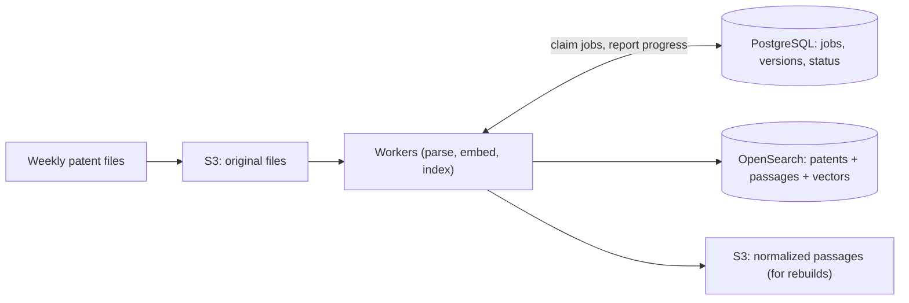
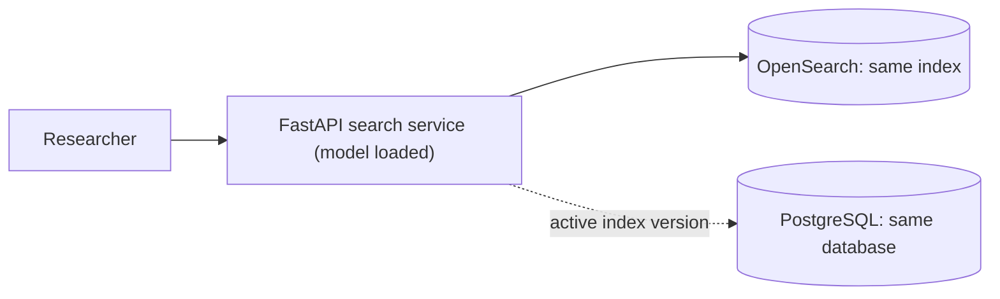

# Part 2: Running the patent search at 10 million patents

> **What this is.** A system design that extends Part 1 to 10 million patents, plus a small
> proof of concept (PoC) of its ingestion pipeline. The design is a proposal: nothing here has
> been deployed or load-tested at 10 million patents. Figures marked *measured* come from
> Part 1's 640-patent sample; everything else is labelled as an assumption or an illustrative
> scenario.

## 1. Goal and assumptions

A researcher enters an invention description or a claim, optionally narrows the results by
classification prefix, title words, abstract words or an exact title, and gets ranked patent
publications, each with the original passages that matched. Similar-patent search by patent ID
(Part 1's `--similar-to`) and exact lookups must work without running the model. Similarity is
research help, not a legal conclusion.

| Property | Value | Status |
|---|---|---|
| Corpus | 10 million patent publications | **Given** by the brief |
| Response | Top 10 publications, up to 3 matching passages each; filters always strict | Carried over from Part 1 |
| Load | 20 searches per second as a load-test scenario; p95 under 1 second as a goal | **Assumption**: real usage is unknown |
| Freshness | A new batch searchable within 24 hours of arriving | **Assumption** |
| Hosting | AWS, used only to price the design | **Assumption**: any cloud works |
| Confidentiality | Queries may describe unpublished inventions: authenticate users, embed queries in-house, don't log query text | **Assumption** |
| Data | US English publications to start; optional `jurisdiction` and `language` fields, `unknown` allowed | Cheap now; translation is out of scope |

## 2. Sizing, from Part 1's measurements

Part 1's sample has 640 patents in 64 weekly files. Its per-patent figures scale linearly to
10 million, assuming the same mix of patents.

| Quantity | Per patent (measured) | At 10 million patents |
|---|---:|---:|
| Raw JSON | 24.9 KB | ~249 GB |
| Passage text (abstract, claims, description paragraphs) | 25.0 KB | ~250 GB |
| Passages | 54.0 | ~540 million |
| of which claims and abstracts | 17.8 | ~178 million |
| of which description paragraphs | 36.2 | ~362 million |
| Vectors, 384 dimensions × 4 bytes | 83 KB | ~829 GB |
| Embedding on one laptop CPU | 20–29 passages/s | ~8 months for the backfill |
| Exact search of every vector | 1.87 ms per 34,551 vectors | ~29 s per query |

The last two rows drive the design: embedding needs GPUs working in parallel, and search needs
an index that avoids scoring every vector.

## 3. Architecture

Two flows share the same stores. New files enter the **ingestion pipeline** in the background;
searches enter the **search pipeline**. The boxes with the same name are the same service.

**A. Ingestion (background)**



**B. Search (interactive)**



| Component | Job | Why |
|---|---|---|
| **S3** | Original files, unchanged; normalized passages | The source of truth. Any index can be rebuilt from it, and every transformation can be checked against the original |
| **PostgreSQL** | Job queue, patent versions, per-record outcomes, counts, active index version | Transactions make claiming jobs and recording results safe. One small database, easy to inspect |
| **Workers** | Parse and clean with Part 1's loader, embed, write to OpenSearch | Run independently of searches. CPU workers for weekly batches; temporary GPU workers for the backfill |
| **OpenSearch** | BM25 keyword search, vector search and filters, in one engine | Distributed, so it scales by adding nodes. A derived index, not the source of truth |
| **FastAPI** | Authenticates, validates filters, embeds the query, runs both searches, merges them, returns passages | Stateless, so more copies can be added behind a load balancer when traffic needs it |

**Kept deliberately simple:** one search engine, one database, no Kafka, Redis, separate vector
database or model-serving service. Each of these could be added later if a measurement calls for
it.

## 4. Search design

### 4.1 Why both keyword and semantic search

Part 1 measured both on the same passages (README, *Search quality*). With the claim as the query,
BM25 found the right patent first 86.5% of the time against 52.4% for semantic search. With
everyday-language queries, semantic search scored higher (nDCG@10 0.475 against 0.335), most
clearly when the query and the patent shared few words. Each fails where the other works, so the
design runs both.

### 4.2 Index layout: one document per patent, passages nested

Each patent is one OpenSearch document. Patent-level fields (ID, title, abstract, classification
prefixes, publication date, jurisdiction, language, version) sit at the top; each passage
(type, label, original text, vector) is a **nested** object inside it.

This layout gives Part 1's behaviour directly:

- **Ranked by best passage.** For nested vector search, OpenSearch uses each patent's nearest
  passage to decide whether to include it, which is Part 1's "rank each patent by its best
  passage". BM25 over nested passages does the same with `score_mode: max`.
- **Evidence comes back with the result.** `inner_hits` returns the passages that matched, so the
  API never fetches text from anywhere else.
- **Filters stay at patent level.** OpenSearch accepts filters on top-level fields inside a nested
  vector search, so the title, abstract and classification don't have to be copied onto 54
  passages each.

**What this layout costs.** OpenSearch stores a patent and its nested passages as one block, so
changing any passage rewrites the whole patent: all its passages and their vectors. That is cheap
here because patents are written once: a new publication is a new document, and a model change
builds a new index anyway (section 6). Large patents with hundreds of passages make bigger, uneven
writes, which the ingestion workers absorb by batching.

**When one document per passage is better** (patent fields copied onto each passage, and the API
groups results by patent): if passages are updated one at a time (per-passage annotations or
partial re-embedding), if very large patents make writes or merges slow, or if the pilot shows
nested search returning too few results with filters (see 4.5). It is kept as the fallback.

### 4.3 What gets embedded: every passage, compressed

**Chosen:** every passage gets a vector, stored in OpenSearch's disk-based mode. Since version
2.17, that mode keeps 32×-compressed (binary-quantized) vectors in memory and full-precision
vectors on disk. A search first runs on the compressed index, then rescores the candidates with
the full-precision vectors. AWS gives the memory need as `1.1 × (bits × d/8 + 8 × m)` bytes per
vector: about **194 bytes** for 384 dimensions, 1 bit per dimension and the default graph
setting m = 16.

| Option | Vectors | Memory per copy | What it can miss | Monthly cost (section 8) |
|---|---:|---:|---|---:|
| **Every passage (chosen)** | 540M | ~105 GB | Least: every passage is searchable by meaning | ~$7,370 |
| Claims and abstracts only | 178M | ~34 GB | A description paragraph that shares no words with the query | ~$4,770 |
| Three selected passages per patent | 30M | ~6 GB | The same, plus most claims; and "selected" needs a rule | ~$4,630 |

**Why every passage:** missing relevant prior art is the costly failure in this field, and Part 1's
paraphrase test showed semantic search matters most exactly where the wording differs from the
patent. It is also Part 1's design unchanged.

**Measured on Part 1's 12 benchmark queries** (semantic search over the 640 patents, run once over
all passages and once with description paragraphs removed):

- In 64% of top-10 results, the best-matching passage was a **description paragraph**.
- Without descriptions, on average only **5.3 of the 10** results stayed the same; the
  everyday-language queries changed most (as few as 1 of 10), the long claim-style query least
  (8 of 10).
- The 56 patents that dropped out of the top 10 fell to a median rank of **49**.

This shows the results would change a lot, not that they would get worse: whether the patents that
dropped out were relevant wasn't judged. The keyword search would still cover descriptions in the
cheaper option. But for natural-language queries, the main use case, semantic matches come mostly
from descriptions, so removing them is a large change to make for cost alone.

**What it costs:** about $2,600 a month more than claims and abstracts only. If that is too much,
claims and abstracts only is the next step down. Three passages per patent saves only another
~$140 a month, because the cluster's size is then set by the keyword index, not by the vectors.

### 4.4 One search, step by step

For `"adaptive battery cooling"` with classification prefix `H01M`:

1. The API authenticates the request, validates the filters, and embeds the query once (Part 1
   measured about 8 ms on CPU).
2. **Keyword search:** BM25 over the nested passages, filtered to `H01M`, best passage per patent,
   top 200 patents.
3. **Semantic search:** vector search over the nested passages with the same filter applied inside
   the search (OpenSearch's efficient filtering, which falls back to exact search when few patents
   pass, which is the same crossover Part 1 measured), top 200 patents.
4. **Merge** the two patent lists with reciprocal rank fusion, `score = Σ 1/(60 + rank)`. This is
   a starting point, not a proven choice: on Part 1's tests it was never far from the better
   method but never clearly the best (D18). Each list's results are logged separately so the
   merge can be judged and changed.
5. Return the top 10 patents with up to 3 matching passages each from `inner_hits`, plus the index,
   model and ranking versions used.
6. If the filters match nothing, return an empty result with Part 1's suggestions. Filters are
   never loosened silently.

**Why merge both when Part 1 defaults to semantic search?** Part 1 kept semantic search as its
default because its main input is a plain-language description, where Part 1's paraphrase test
favoured it. A production system also gets the other kind of query: attorneys paste claim
language, where BM25 found the right patent first 86.5% of the time against 52.4%. Merging was never
far from the better method in either test, so it is the safest single default while the query mix
is unknown. It stays provisional: a judged relevance test split by query type decides. If semantic
search wins on descriptions and BM25 on claims, the API should route by query type instead of
merging; if merging loses to semantic search overall, it is dropped.

**Similar to a patent ID** looks up that patent's stored abstract and first-claim vectors and runs
step 3 with the patent excluded, as in Part 1, with no model needed. **Exact title or ID lookups**
are plain filter queries.

### 4.5 Limits of this search design

- **Approximate search can miss neighbours.** Compression plus rescoring keeps most of the recall,
  but not all of it. The pilot must measure recall against exact search on a sample.
- **RRF is untested at scale.** Both lists are kept and logged so the merge can be replaced.
- **The model is general-purpose.** Part 1 showed it is weaker than BM25 when the wording matches.
  A model change means re-embedding everything (section 6).
- **The four OpenSearch features are untested together.** Nested vector fields, disk-based
  compression, filters on patent-level fields inside a nested vector search, and `inner_hits` are
  each documented, but not verified in combination here. A bug report against OpenSearch 2.17.1
  describes nested vector searches with filters returning fewer results than they should. **First
  pilot task:** index about 20 known patents on the chosen version and check that filters stay
  strict, each patent is ranked by its best passage, `inner_hits` returns the right passages, and
  the results match exact search. If any check fails, use one document per passage (4.2).

## 5. Ingestion pipeline

### 5.1 Steps

`file arrives → save original to S3 → register job → worker claims job → parse and clean →
record each patent's outcome → embed passages not seen before → bulk-write to OpenSearch →
check every write → mark the job done → update status`

Embedding skips any passage whose exact text was embedded before by the same model (Part 1's
embedding cache, keyed by model and text).

### 5.2 Records in PostgreSQL

```sql
CREATE TABLE ingestion_jobs (
  id               bigserial PRIMARY KEY,
  source_key       text NOT NULL,        -- e.g. s3://patents/raw/ipa240215.json
  checksum         text NOT NULL,        -- sha256 of the file
  pipeline_version text NOT NULL,        -- changes when parsing or cleaning rules change
  state            text NOT NULL,        -- queued | processing | retry_wait | complete
                                         -- | complete_with_errors | failed
  attempt          int  NOT NULL DEFAULT 0,
  next_attempt_at  timestamptz NOT NULL DEFAULT now(),
  lease_until      timestamptz,
  lease_token      uuid,
  records_total    int, records_saved int, records_quarantined int,
  last_error       text,
  created_at       timestamptz NOT NULL DEFAULT now(),
  finished_at      timestamptz,
  UNIQUE (source_key, checksum, pipeline_version)
);

CREATE TABLE publication_versions (
  publication_id   text NOT NULL,        -- e.g. 20240051333
  content_hash     text NOT NULL,        -- sha256 of the cleaned record
  jurisdiction     text NOT NULL DEFAULT 'US',
  language         text NOT NULL DEFAULT 'unknown',
  title text, classification text, publication_date date,
  passages         int,
  job_id           bigint REFERENCES ingestion_jobs(id),
  state            text NOT NULL,        -- saved | indexed | conflict
  indexed_in       text,                 -- index version it is searchable in
  PRIMARY KEY (publication_id, content_hash)
);

CREATE TABLE source_records (
  job_id           bigint REFERENCES ingestion_jobs(id),
  record_position  int NOT NULL,         -- position of the record in the file
  publication_id   text,
  outcome          text NOT NULL,        -- saved | unchanged | quarantined | conflict
  error_reason     text,
  PRIMARY KEY (job_id, record_position)
);
```

### 5.3 Job states

```text
queued ──claim──> processing ──all records ok──────────> complete
                      │
                      ├── some records quarantined ──────> complete_with_errors
                      ├── temporary error ──> retry_wait ──(after a delay)──> processing
                      └── retries used up ───────────────> failed
```

A job is `complete_with_errors` only when every bad record has a row in `source_records` with its
reason and the counts add up. `failed` keeps its last error. Neither is ever shown as a plain
success.

### 5.4 Claiming jobs safely, and recovering from crashes

- **Claiming:** a worker picks one job inside a short transaction with `SELECT … FOR UPDATE SKIP
  LOCKED`, so two workers never take the same job, then sets it to `processing` with a new
  `lease_token` and `lease_until` a few minutes ahead.
- **`SKIP LOCKED` alone is not crash recovery.** The row lock ends when that transaction commits,
  while the work takes longer. If the worker dies, the job would stay `processing` forever.
- **Leases handle crashes.** A job whose lease has expired can be claimed again. A working worker
  extends its lease as it goes. Every status update requires the current `lease_token`, so a worker
  that was presumed dead and wakes up later can't mark someone else's attempt as finished.
- **Retries** wait longer each time (for example 1, 4, then 16 minutes); after the last attempt
  the job becomes `failed`.

### 5.5 Three different duplicate problems

| Problem | Protection |
|---|---|
| The same file registered twice | `UNIQUE (source_key, checksum, pipeline_version)`: the second registration finds the existing job |
| A retry after a crash writes the same patents again | Writes are upserts keyed by `(publication_id, content_hash)` in Postgres and by publication ID in OpenSearch, so writing twice changes nothing |
| The same patent ID arrives with different content | Both versions are kept with different hashes, the newer is marked `conflict`, and it waits for a rule or a person. Nothing is overwritten silently |

### 5.6 What can go wrong

| Failure | Detected by | Response | Visible as |
|---|---|---|---|
| File can't be read | Read or parse error | Retry if temporary; `failed` if the file itself is corrupt | Job state, `last_error` |
| One bad patent in a good file | Validation error at a record position | Quarantine that record with its reason; save the rest | `complete_with_errors`, quarantine count |
| Worker crashes mid-job | Lease expires | Another worker reclaims the job; upserts make the replay safe | Attempt count, oldest job age |
| Bulk write partly fails | Per-item errors in the bulk response (a 200 response doesn't mean every item succeeded) | Retry the failed items; quarantine permanent rejects | Indexed vs failed counts |
| Embedding fails | Error from the model | Retry with back-off | `retry_wait` |
| OpenSearch is down during a search | Error or timeout | Return an error, never a silently partial result | API error rate |

## 6. Versions and re-indexing

- **Weekly batches** are added to the live index. Postgres distinguishes *saved* from *indexed*,
  so a patent counts as searchable only after its write is confirmed.
- **A new model or cleaning rule** means a new index version, built next to the live one. It is
  checked (counts, sample queries, the Part 1 evaluation), then an alias switches searches to it
  with no downtime. The old version is kept until the new one is trusted.
- **Every response records** the index, model and ranking versions, so a past result can be
  explained. Replaying an old search exactly also needs the old index to be kept, which is a
  retention decision.

## 7. Knowing what the system contains

The brief asks how we know the system's contents and state, not just whether servers are up. A
`status` command (an admin endpoint in production) answers it from Postgres and OpenSearch.

Example output (illustrative values):

```text
ACTIVE INDEX   patents-v004  model all-MiniLM-L6-v2  pipeline v3
JOBS           queued 2  processing 1  retry_wait 1  complete 12,481
               complete_with_errors 11  failed 2   oldest waiting 2h 10m
PUBLICATIONS   saved 9,998,100  indexed 9,987,500  quarantined 2,300  conflicts 175
PASSAGES       expected 539,400,000  in index 539,388,000  (gap 12,000 → repair jobs)
SEARCH         p95 740 ms  errors 0.1%  disk 64%  k-NN memory 81%
```

| Value | Comes from |
|---|---|
| Jobs by state, oldest waiting job | `ingestion_jobs` |
| Saved, indexed, quarantined, conflicts | `publication_versions`, `source_records` |
| Expected vs actual passages | Sum of `passages` for indexed patents vs OpenSearch's nested document count |
| Active versions | The index alias and its manifest |
| Latency, errors, disk, memory | API and OpenSearch metrics |

**Reconciliation:** if expected and actual counts differ, a job compares patent IDs and creates
repair jobs for what is missing, instead of assuming the systems agree.

**Alerts:** no successful job within the expected cadence; a job waiting longer than the freshness
target; a rising quarantine rate; a count gap that persists; disk or k-NN memory near their limits;
p95 or error rate above target.

## 8. Capacity and cost

This is a planning model with every input visible, not a measured deployment. A pilot (section 9)
replaces the assumptions with measurements before anything is bought.

### 8.1 Storage and memory

| Item | Calculation | Result |
|---|---|---:|
| Keyword index | 250 GB passage text × 3 (assumed expansion for the inverted index and stored text) | 750 GB |
| Vectors on disk | 540M × 1,536 bytes (full precision, for rescoring) + 105 GB compressed | 934 GB |
| One copy | 750 + 934 | 1.68 TB |
| With one replica | × 2 | 3.37 TB |
| Provisioned disk | ÷ 0.65 (keep a third free) | 5.2 TB → **6 TB** |
| k-NN memory needed | 105 GB per copy × 2 | **209 GB** |

On Amazon OpenSearch Service, half of a node's RAM goes to the Java heap (up to 32 GB), and k-NN
may use half of the rest. A 128 GB `r6g.4xlarge` node therefore gives 48 GB to k-NN, so 209 GB
needs **5 data nodes** (240 GB, 87% used).

### 8.2 Illustrative monthly cost (AWS US East, on-demand, 730 hours a month)

| Item | Calculation | $/month |
|---|---|---:|
| OpenSearch data nodes | 5 × 730 h × $1.34 (`r6g.4xlarge.search`, assumed 4× the $0.335 published for `r6g.xlarge.search`) | 4,891 |
| OpenSearch cluster managers | 3 × 730 h × $0.113 (`c6g.large.search`) | 247 |
| OpenSearch disk (gp3) | 6,000 GB × $0.122 | 732 |
| API containers (Fargate) | 2 × 730 × (1 vCPU × $0.04048 + 2 GB × $0.004445) | 72 |
| Load balancer | 730 × ($0.0225 + 1 LCU × $0.008) | 22 |
| PostgreSQL | Allowance for a small instance plus storage and backups | 190 |
| S3 | ~500 GB (originals + normalized passages) × $0.023 | 12 |
| Weekly batch workers | Allowance: 160 task-hours × (2 vCPU × $0.04048 + 4 GB × $0.004445) | 16 |
| Logs and metrics | Allowance | 75 |
| Network | Allowance; depends heavily on the deployment | 150 |
| **Subtotal** | | **6,407** |
| Contingency | 15% | 961 |
| **Illustrative total** | | **~$7,370** |

The two cheaper vector options in section 4.3 change only the data-node and disk lines: claims and
abstracts only needs 69 GB of k-NN memory and 3.5 TB of disk (3 data nodes, the assumed minimum for
the keyword index), about **$4,770**; three passages per patent needs 2.5 TB of disk on the same
3 nodes, about **$4,630**.

**Sensitivity.** The 5 nodes run at 87% of their vector-memory allowance, which leaves little room
for growth or uneven shards, and every input below is an assumption or an extrapolation from 640
patents. Each change, on its own:

| If… | Effect | Extra per month (before contingency) |
|---|---|---:|
| Memory is kept at 70% use instead of 87% (more headroom) | 7 data nodes | ~$1,960 |
| Patents average 80 passages instead of 54 | 310 GB of vector memory: 7 nodes, 8 TB disk | ~$2,200 |
| Two replicas instead of one (higher availability) | 314 GB of vector memory: 7 nodes, 8 TB disk | ~$2,200 |
| The keyword index expands 6× instead of 3× | 8 TB disk (vector memory unchanged) | ~$240 |

The figure most likely to move is passages per patent, because a sample of 640 vehicle patents
may not represent the whole corpus; the pilot measures it first. **Nothing here shows that 5 nodes
meet the latency goal**: the cluster is a costed starting point, not a validated configuration.

### 8.3 One-off backfill

`540M passages ÷ (passages per second per GPU × GPUs) ÷ 3,600 × price per GPU-hour`, plus bulk
indexing time. GPU throughput for this model hasn't been measured here, so no dollar figure is
claimed. As an illustration of the formula only: at 2,000 passages a second per GPU, the backfill is
75 GPU-hours. Spot GPUs suit it because a reclaimed machine is just a crashed worker: its lease
expires and another worker takes the job.

## 9. Major challenges

| Challenge | Response |
|---|---|
| **Memory for 540 million vectors** | Compressed disk-based vectors (section 4.3), with two cheaper fallbacks priced. Watch k-NN memory and add nodes before it fills |
| **Recall** | Approximate search and RRF can both lose relevant patents. Measure recall against exact search on a sample, and keep running Part 1's evaluation on each index version |
| **Keeping Postgres and OpenSearch consistent** | At-least-once processing with idempotent writes, per-item checks, leases, and reconciliation that creates repair jobs |
| **Data quality at scale** | Part 1's problems (lost claim numbers, empty paragraphs, text over the token limit) will appear across the corpus, so the cleaning rules run in the workers and their counts are reported per job |
| **Re-embedding after a model change** | Versioned indexes avoid downtime and the embedding cache skips unchanged text, but a new model still means re-embedding all 540 million passages |

**Pilot before buying:** index about 1% of the corpus (100,000 patents) and measure passages and index size per
patent, k-NN memory, nested-search behaviour with filters, recall against exact search, and p95 under
concurrent load.

## 10. Build order for an intern

| Step | Build | Done when |
|---|---|---|
| 1 | Postgres schema and the ingestion PoC (section 11) | Retries, duplicates and status work on real files |
| 2 | Original files in S3, registered on arrival | A new file creates exactly one job |
| 3 | OpenSearch index with nested passages and BM25 | Keyword search with filters returns patents and passages |
| 4 | Embedding workers and the vector field | Semantic search works; counts reconcile |
| 5 | FastAPI with both searches and RRF | Part 1's queries return comparable results |
| 6 | Index versions, alias switching, status endpoint | A rebuild switches with no downtime |
| 7 | Pilot at 1%, then the backfill | The section 9 measurements are in hand |

## 11. Proof of concept: reliable ingestion

**What it shows:** the parts of the design that are hardest to get right: claiming jobs safely,
retries, crash recovery, no duplicates, quarantine, and status. It runs on Part 1's real data.

**What it doesn't show:** OpenSearch, embeddings, or anything about 10-million-patent performance.

**Setup:** PostgreSQL in Docker (`docker-compose.yml`); the Python code runs in the project's
virtual environment and reuses Part 1's parsing and cleaning. Inputs are the 64 weekly files, plus
one hand-made file with a malformed record.

**Planned demonstration:**

1. Register the 64 files: 64 jobs.
2. Run two workers: they share the jobs without overlap.
3. Register the same file again: no new job.
4. Kill a worker mid-job: once its lease expires, another worker finishes the job, and the patent
   count doesn't change.
5. Process the malformed file: `complete_with_errors`, with the bad record and its reason listed.
6. Run `status`: jobs by state, patents saved, quarantined records, oldest waiting job.

**How to run it:** see [`poc/README.md`](../poc/README.md).

**Result on Part 1's data,** with worker A stopped mid-job (Ctrl+C) and worker B started
afterwards:

```text
[B] job 1 attempt 2: patents_ipa240215.json (previous: lease of A expired)
[B]   → complete (10 saved)
...
[B] job 65 attempt 1: patents_ipa991230_corrupt.json
[B]   → failed: file is not valid JSON: Unterminated string starting at: line 1 column 41 (char 40)
[B] job 66 attempt 1: patents_ipa991231_with_bad_records.json
[B]   → complete_with_errors (1 saved, 3 quarantined)

$ python -m poc.status
JOBS      66 total · queued 0 · processing 0 · retry_wait 0 · complete 64 · complete_with_errors 1 · failed 1
          oldest unfinished: none · needed more than one attempt: 1
RECORDS   644 read · saved 641 · unchanged 0 · conflict 0 · quarantined 3
PATENTS   641 unique · 0 conflicting versions · 32146 passages
```

Job 1 was finished by B on its second attempt, and the patent count is the same as in a run
without the crash: nothing was lost or stored twice. Registering the same 66 files again created
no new jobs.

Ten tests in `tests/test_poc.py` check every guarantee, including the ones not shown above: a job
locked by one worker is skipped by another, a temporary error is retried and the job fails after
its last attempt, the same patent arriving again is `unchanged` while different content under the
same ID is a `conflict`, a lease expiring on the final attempt fails the job, and a stale worker
can't finish a job it lost.

**Passages** here are counted before splitting to the model's token limit (abstract + claims +
description paragraphs), so the figure differs from Part 1's 34,551 units.

## References

- [PostgreSQL: `SELECT … FOR UPDATE SKIP LOCKED`](https://www.postgresql.org/docs/current/sql-select.html)
- [OpenSearch: disk-based vector search](https://docs.opensearch.org/latest/vector-search/optimizing-storage/disk-based-vector-search/)
- [OpenSearch: nested field vector search](https://docs.opensearch.org/latest/vector-search/specialized-operations/nested-search-knn/)
- [OpenSearch: efficient k-NN filtering](https://docs.opensearch.org/latest/vector-search/filter-search-knn/efficient-knn-filtering/)
- [OpenSearch: bulk API and per-item errors](https://docs.opensearch.org/latest/api-reference/document-apis/bulk/)
- [AWS: OpenSearch quantization and memory formula](https://aws.amazon.com/blogs/big-data/cost-optimized-vector-database-introduction-to-amazon-opensearch-service-quantization-techniques)
- [AWS: k-NN memory on OpenSearch Service](https://docs.aws.amazon.com/opensearch-service/latest/developerguide/knn.html)
- Pricing: [OpenSearch Service](https://aws.amazon.com/opensearch-service/pricing/), [Fargate](https://aws.amazon.com/fargate/pricing/), [RDS](https://aws.amazon.com/rds/postgresql/pricing/), [S3](https://aws.amazon.com/s3/pricing/), [Load Balancing](https://aws.amazon.com/elasticloadbalancing/pricing/). Verify all rates in the [AWS Pricing Calculator](https://calculator.aws/).
